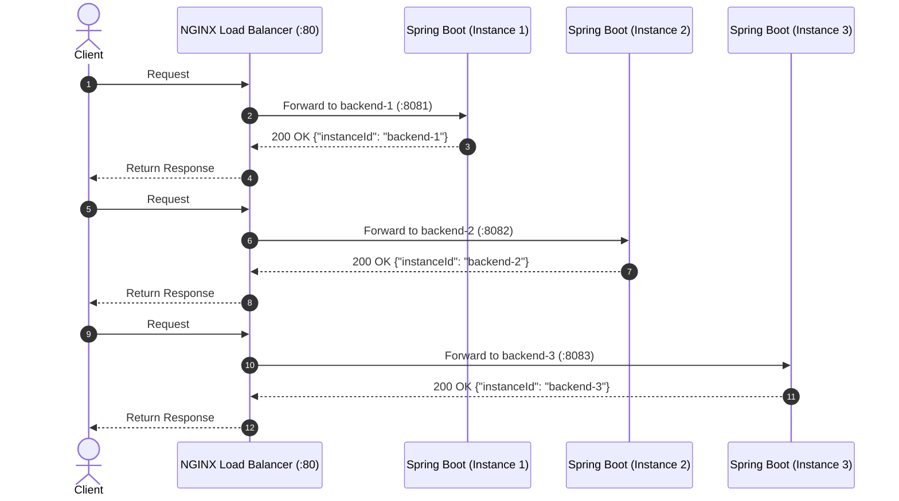

# ⚖️ NGINX Load Balancer with Spring Boot & Docker Compose

[](https://www.docker.com/)
[](https://nginx.org/)
[](https://spring.io/projects/spring-boot)
[](https://openjdk.org/)
[](LICENSE)

An end-to-end, production-ready demonstration of **Layer 7 HTTP Load Balancing** using **NGINX** as a reverse proxy, distributing incoming traffic across three containerized **Spring Boot 3** backend instances orchestrated via **Docker Compose**.

---

## 📑 Table of Contents

- [What is a Load Balancer?](#-what-is-a-load-balancer)
- [How Does a Load Balancer Work?](#-how-does-a-load-balancer-work)
- [Key Benefits of Load Balancing](#-key-benefits-of-load-balancing)
- [Load Balancing Algorithms](#-load-balancing-algorithms)
- [System Architecture](#-system-architecture)
- [Project Structure](#-project-structure)
- [Configuration Deep Dive](#-configuration-deep-dive)
  - [1. NGINX Configuration (`nginx.conf`)](#1-nginx-configuration-nginxconf)
  - [2. Multi-Stage Dockerfile](#2-multi-stage-dockerfile)
  - [3. Docker Compose Orchestration](#3-docker-compose-orchestration)
- [Quickstart & Deployment](#-quickstart--deployment)
  - [Prerequisites](#prerequisites)
  - [Running with Docker Compose (Recommended)](#running-with-docker-compose-recommended)
  - [Running Manually on Host Machine](#running-manually-on-host-machine)
- [Verifying Load Distribution](#-verifying-load-distribution)
- [Health Checks & Failover](#-health-checks--failover)
- [Troubleshooting](#-troubleshooting)

---

## 🌐 What is a Load Balancer?

A **Load Balancer** is a critical architectural component in distributed systems that sits between client devices and a pool of backend servers. Its primary responsibility is to accept incoming network or application traffic and intelligently distribute it across multiple healthy target instances.

Without a load balancer, a single server handles all incoming requests, creating a **Single Point of Failure (SPOF)** and a performance bottleneck.

```
       [ Without Load Balancer ]                      [ With Load Balancer ]
                                                         
  Client A ──┐                                   Client A ──┐    ┌──> [ Server 1 ]
  Client B ──┼──> [ Single Server ] (Overloaded) Client B ──┼──> │ ⚖️ Load │ ──┼──> [ Server 2 ]
  Client C ──┘                                   Client C ──┘    │Balancer│ ──┴──> [ Server 3 ]
                                                                 └────────┘
```

---

## ⚙️ How Does a Load Balancer Work?

A load balancer operates through a continuous cycle:

1. **Traffic Interception**: Listens on public-facing IP addresses and ports (e.g., port `80` for HTTP or `443` for HTTPS).
2. **Health Monitoring**: Periodically evaluates the responsiveness and readiness of each backend node using TCP checks or HTTP endpoints (`/health` or `/actuator/health`).
3. **Algorithm Execution**: When a client request arrives, the load balancer applies its configured routing policy (e.g., Round Robin, Least Connections).
4. **Request Forwarding (Reverse Proxy)**: Modifies request headers (e.g., `X-Forwarded-For`, `Host`, `X-Real-IP`) and proxies the request to the chosen backend server.
5. **Response Relaying**: Receives the response from the backend and transmits it back to the original client.



---

## 🚀 Key Benefits of Load Balancing

| Benefit | Description |
|---|---|
| **High Availability (HA)** | Automatically removes unhealthy instances from the routing table so users experience zero downtime. |
| **Horizontal Scalability** | Add or remove backend instances dynamically without changing client-facing URLs or DNS records. |
| **Fault Tolerance** | If one node crashes, remaining nodes absorb the traffic seamlessly. |
| **Security & Isolation** | Backends remain in a private network or internal interface; only the load balancer is publicly exposed. |
| **SSL Offloading / Termination** | Cryptographic handshakes are handled at the load balancer level, freeing CPU cycles on backend application servers. |

---

## 🧠 Load Balancing Algorithms

Load balancers use different strategies depending on application workload, request duration, and hardware parity:

### 1. Round Robin *(Default in NGINX)*
- **How it works**: Requests are distributed sequentially across the list of servers one by one.
- **Best for**: Clusters where all backend servers have equal hardware specifications and requests require similar processing time.
- **NGINX syntax**:
  ```nginx
  upstream backend {
      server host.docker.internal:8081;
      server host.docker.internal:8082;
      server host.docker.internal:8083;
  }
  ```

### 2. Weighted Round Robin
- **How it works**: Servers with higher processing power or RAM receive a proportionally higher share of requests.
- **Best for**: Heterogeneous server environments.
- **NGINX syntax**:
  ```nginx
  upstream backend {
      server host.docker.internal:8081 weight=3; # Receives 3 out of 5 requests
      server host.docker.internal:8082 weight=1;
      server host.docker.internal:8083 weight=1;
  }
  ```

### 3. Least Connections (`least_conn`)
- **How it works**: Forwards the new request to the server with the fewest active, concurrent connections.
- **Best for**: Workloads with unpredictable processing times (e.g., long-running database queries, file uploads, WebSocket sessions).
- **NGINX syntax**:
  ```nginx
  upstream backend {
      least_conn;
      server host.docker.internal:8081;
      server host.docker.internal:8082;
      server host.docker.internal:8083;
  }
  ```

### 4. IP Hash (`ip_hash`)
- **How it works**: Uses a hash of the client's IPv4/IPv6 address to ensure a particular client is always mapped to the same backend server (session affinity / sticky sessions).
- **Best for**: Stateful applications maintaining non-distributed in-memory sessions.
- **NGINX syntax**:
  ```nginx
  upstream backend {
      ip_hash;
      server host.docker.internal:8081;
      server host.docker.internal:8082;
      server host.docker.internal:8083;
  }
  ```

### 5. Generic Hash & Consistent Hashing (`hash <key> [consistent]`)
- **How it works**: Uses a custom key such as an HTTP header, URI, or cookie to determine the target server.
- **Best for**: Distributed caching architectures.

---

## 🏗️ System Architecture

This project spins up four services using Docker:

1. **`nginx-lb`**: An Alpine-based NGINX reverse proxy listening on port `80`.
2. **`backend-1`**: Spring Boot 3 running on port `8080`, mapped to host port `8081`.
3. **`backend-2`**: Spring Boot 3 running on port `8080`, mapped to host port `8082`.
4. **`backend-3`**: Spring Boot 3 running on port `8080`, mapped to host port `8083`.

```
                  Client Request (HTTP GET http://localhost/)
                                       │
                                       ▼
                       ┌───────────────────────────────┐
                       │   NGINX Load Balancer (:80)   │
                       │     (Reverse Proxy Engine)    │
                       └───────────────┬───────────────┘
                                       │
                    ┌──────────────────┼──────────────────┐
                    │ (Round-Robin)    │ (Round-Robin)    │ (Round-Robin)
                    ▼                  ▼                  ▼
          ┌──────────────────┐ ┌──────────────────┐ ┌──────────────────┐
          │   backend-1      │ │   backend-2      │ │   backend-3      │
          │  Spring Boot     │ │  Spring Boot     │ │  Spring Boot     │
          │  Port: 8081      │ │  Port: 8082      │ │  Port: 8083      │
          └──────────────────┘ └──────────────────┘ └──────────────────┘
```

---

## 📁 Project Structure

```
Load_Balancer/
├── nginx.conf                 # NGINX upstream & reverse proxy configuration
├── docker-compose.yml         # Container definitions for NGINX and 3 Spring Boot nodes
├── README.md                  # Comprehensive documentation
└── backend-app/               # Spring Boot microservice source code
    ├── Dockerfile             # Multi-stage Docker build (Maven + Temurin JRE)
    ├── pom.xml                # Maven project descriptor (Spring Boot 3.2.5)
    └── src/
        └── main/
            ├── java/com/loadbalancer/app/
            │   ├── BackendApplication.java       # Spring Boot main runner
            │   └── controller/
            │       └── AppController.java        # REST Controller identifying instance & port
            └── resources/
                └── application.properties        # Application defaults & actuator config
```

---

## 🔍 Configuration Deep Dive

### 1. NGINX Configuration (`nginx.conf`)

[nginx.conf](file:///c:/Users/lenovo/Load_Balancer/nginx.conf) sets up the upstream pool and proxies requests:

```nginx
worker_processes auto;

events {
    worker_connections 1024;
}

http {
    # Upstream pool containing our 3 backend instances
    upstream backend {
        server host.docker.internal:8081;
        server host.docker.internal:8082;
        server host.docker.internal:8083;
    }

    server {
        listen 80;

        location / {
            proxy_pass         http://backend;
            proxy_http_version 1.1;

            # Forward client headers to the backends
            proxy_set_header   Host              $host;
            proxy_set_header   X-Real-IP         $remote_addr;
            proxy_set_header   X-Forwarded-For   $proxy_add_x_forwarded_for;
            proxy_set_header   X-Forwarded-Proto $scheme;
        }

        # Health check for the load balancer itself
        location /health {
            access_log off;
            return 200 'OK';
            add_header Content-Type text/plain;
        }
    }
}
```

### 2. Multi-Stage Dockerfile

[backend-app/Dockerfile](file:///c:/Users/lenovo/Load_Balancer/backend-app/Dockerfile) utilizes Docker multi-stage builds:
- **Build stage**: Uses `maven:3.9-eclipse-temurin-17-alpine` to compile and package the JAR.
- **Runtime stage**: Uses a lightweight `eclipse-temurin:17-jre-alpine` runtime container, keeping image size minimal and secure.

### 3. Docker Compose Orchestration

[docker-compose.yml](file:///c:/Users/lenovo/Load_Balancer/docker-compose.yml) binds each service together:
- Uses `extra_hosts: ["host.docker.internal:host-gateway"]` for cross-platform compatibility across Windows, macOS, and Linux.
- Sets environment variables `APP_INSTANCE_ID` and `SERVER_PORT` uniquely per replica.

---

## 🛠️ Quickstart & Deployment

### Prerequisites

- [Docker Engine & Docker Compose](https://docs.docker.com/get-docker/) (Docker Desktop on Windows/macOS or Docker Engine on Linux)
- *(Optional for manual run)*: [Java 17+](https://adoptium.net/) and [Maven 3.8+](https://maven.apache.org/)

---

### Running with Docker Compose (Recommended)

1. **Clone and navigate to the directory**:
   ```bash
   cd Load_Balancer
   ```

2. **Build and launch all 4 containers**:
   ```bash
   docker compose up -d --build
   ```

3. **Verify the container status**:
   ```bash
   docker compose ps
   ```
   *Output should show `backend-1`, `backend-2`, `backend-3`, and `nginx-load-balancer` running.*

4. **Follow live logs**:
   ```bash
   docker compose logs -f
   ```

5. **Stop and tear down the stack**:
   ```bash
   docker compose down
   ```

---

### Running Manually on Host Machine

If you prefer to compile and run Spring Boot directly on your host machine while running NGINX inside Docker:

1. **Build the Spring Boot JAR**:
   ```bash
   cd backend-app
   mvn clean package -DskipTests
   ```

2. **Launch 3 separate instances in different terminals**:
   ```bash
   # Terminal 1: Port 8081
   java -jar target/backend-app-1.0.0.jar --server.port=8081 --app.instance-id=backend-1

   # Terminal 2: Port 8082
   java -jar target/backend-app-1.0.0.jar --server.port=8082 --app.instance-id=backend-2

   # Terminal 3: Port 8083
   java -jar target/backend-app-1.0.0.jar --server.port=8083 --app.instance-id=backend-3
   ```

3. **Start only the NGINX Load Balancer container**:
   ```bash
   docker compose up -d nginx-lb
   ```

---

## 🧪 Verifying Load Distribution

Send sequential requests to the load balancer at `http://localhost/`:

### Using `curl`

```bash
curl http://localhost/
curl http://localhost/
curl http://localhost/
```

### Sample Output Demonstrating Round-Robin

```json
{"instanceId":"backend-1","port":8080,"message":"Hello from backend instance!","timestamp":"2026-10-18T00:16:30.102"}
{"instanceId":"backend-2","port":8080,"message":"Hello from backend instance!","timestamp":"2026-10-18T00:16:31.450"}
{"instanceId":"backend-3","port":8080,"message":"Hello from backend instance!","timestamp":"2026-10-18T00:16:32.788"}
```

Notice how `instanceId` smoothly cycles through **`backend-1` ➔ `backend-2` ➔ `backend-3`**, proving that NGINX is distributing traffic evenly!

### Inspecting System Metrics

```bash
curl http://localhost/api/info
```

Returns JVM status, available processors, and free memory for the servicing instance:

```json
{
  "instanceId": "backend-2",
  "port": 8080,
  "status": "UP",
  "javaVersion": "17.0.10",
  "availableProcessors": 8,
  "freeMemoryMB": 182,
  "timestamp": "2026-10-18T00:16:45.321"
}
```

---

## 🩺 Health Checks & Failover

NGINX continuously validates server responsiveness:

- **Load Balancer Health Check**: `http://localhost/health`
- **Spring Boot Actuator Health Check**: `http://localhost/actuator/health`

### Simulating Server Failure:
Stop one backend instance to see how NGINX routes around it:
```bash
docker stop backend-2
```
Now send requests to `http://localhost/`. NGINX will automatically skip `backend-2` and route traffic only between `backend-1` and `backend-3` without dropping any client requests.

---

## 🛠️ Troubleshooting

- **`502 Bad Gateway`**:
  - The backend instances are not running or not listening on the expected ports.
  - Check container status with `docker compose ps` and logs with `docker compose logs nginx-lb`.
- **Port Conflict on Port 80**:
  - If another application (like IIS, Apache, or Skype) occupies port 80, modify the host port binding in [docker-compose.yml](file:///c:/Users/lenovo/Load_Balancer/docker-compose.yml) to `"8080:80"` and access via `http://localhost:8080`.
- **`host.docker.internal` not resolving on Linux**:
  - Ensure the `extra_hosts: ["host.docker.internal:host-gateway"]` directive is present in `docker-compose.yml` (already included).

---

## 📄 License

This project is licensed under the MIT License — see the [LICENSE](LICENSE) file for details.
